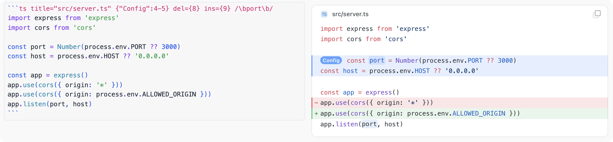
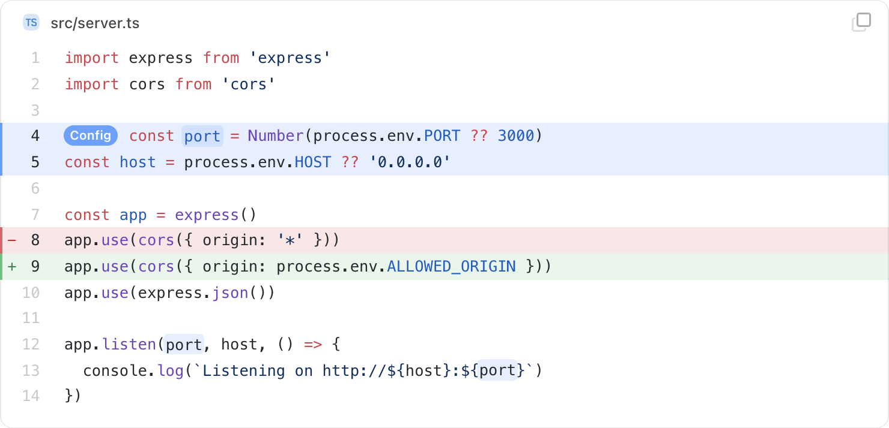
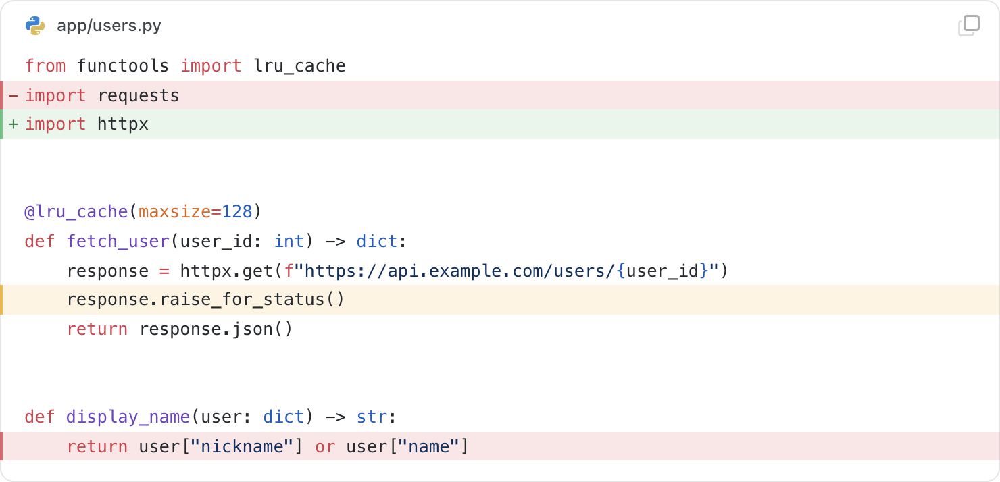
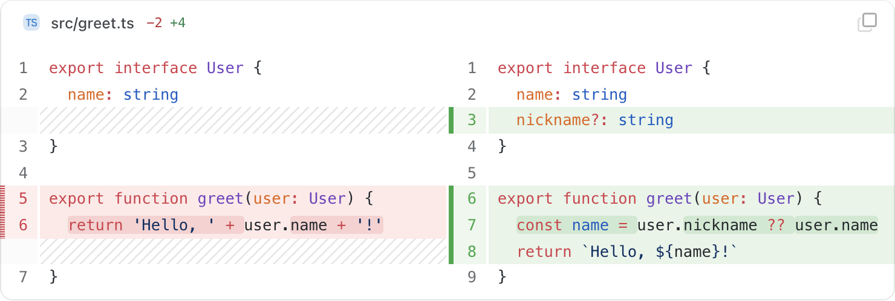
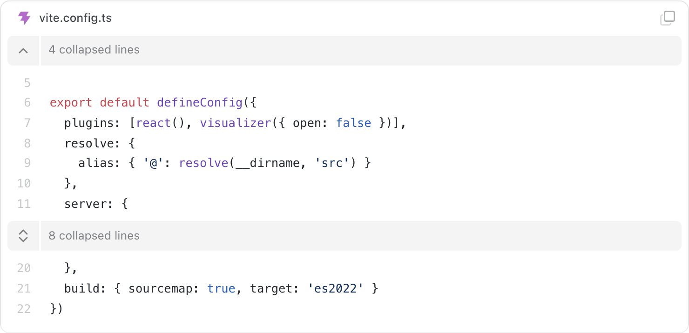
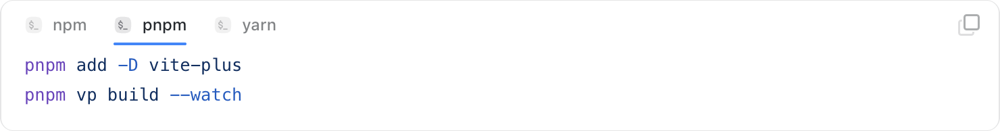
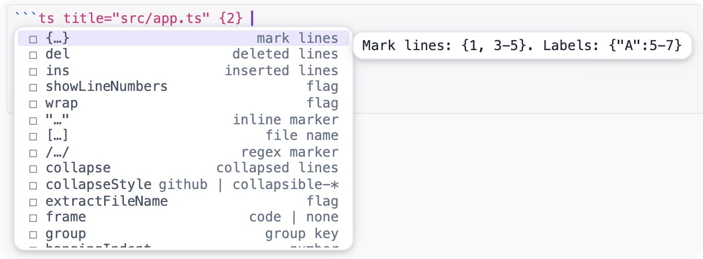

# awesome-codeblock

An [Inkdrop](https://www.inkdrop.app) plugin that renders fenced code blocks with Shiki themes, titles, line and
inline markers, diff views, tabs, collapsible sections and editor completion for the fence syntax.

Inkdrop's built-in code blocks show highlighted code and little else. awesome-codeblock replaces them in the preview
with a frame that understands a rich fence "meta" string — the part after the language — so a note can say which file
the code comes from, which lines changed, which part matters and which part can stay folded.

<picture>
  <source media="(prefers-color-scheme: dark)" srcset="https://raw.githubusercontent.com/inkwadra/awesome-codeblock/main/docs/screenshots/hero-dark.png">
  
</picture>

<sub>The Markdown source in the editor (left) and the rendered block in the preview (right).</sub>

The syntax is a superset of [Expressive Code](https://expressive-code.com), the `[file.ts]` titles from
Comark, Shiki's `// [!code …]` notation comments, and Inkdrop's own code block
options (`title=`, `url=`, `line=`, `branch=`, `commit=`). Notes stay plain Markdown: without the plugin, the same
fences render as ordinary code blocks.

## Table of Contents

- [Features](#features)
- [Requirements](#requirements)
- [Installation](#installation)
- [Usage](#usage)
  - [Titles and file names](#titles-and-file-names)
  - [Line markers](#line-markers)
  - [Inline markers](#inline-markers)
  - [Notation comments](#notation-comments)
  - [Diffs](#diffs)
  - [Collapsible sections](#collapsible-sections)
  - [Tabs](#tabs)
  - [Editor completion](#editor-completion)
  - [Line numbers, wrapping and layout](#line-numbers-wrapping-and-layout)
  - [Inkdrop source info](#inkdrop-source-info)
- [Meta Option Reference](#meta-option-reference)
- [Configuration](#configuration)
- [Styling](#styling)
- [Compatibility](#compatibility)
- [Development](#development)
- [Acknowledgments](#acknowledgments)
- [License](#license)

## Features

- **Shiki highlighting** with 242 languages and 65 themes, separate light and dark themes, and automatic matching of
  the active Inkdrop theme (`nord`, `dracula`, `catppuccin-mocha`, …) to the Shiki theme of the same name.
- **Header** with a file-type icon, the title or language name, an optional link, and copy and wrap buttons.
  A file-name comment in the first lines (`// src/app.ts`) can become the title.
- **Line markers** (`{2-4}`, `ins={5}`, `del={6}`) with optional labels, and **inline markers** for text and regular
  expressions.
- **Shiki notation comments**: `[!code ++]`, `[!code --]`, `[!code highlight]`, `[!code focus]`, `[!code error]`,
  `[!code warning]`, `[!code info]`, `[!code word:…]`.
- **Diff views** for real patches (unified or split columns, word-level changes) via
  [`@pierre/diffs`](https://www.npmjs.com/package/@pierre/diffs), and `+`/`-` line marking for hand-written diffs.
- **Collapsible sections**, a **maximum height** with a "Show all N lines" button, **tabbed groups** whose selection
  can sync across notes.
- **Line numbers**, **word wrap** with preserved or hanging indent, **indent guides**, configurable **tab size**.
- **Editor completion** on fence lines: languages, meta options and their values, and `[!code …]` notations inside
  the code.
- **Export and print** friendly: tabs, cut blocks and diff views render as static, complete code.

## Requirements

- Inkdrop **6.1.3** or later (desktop app).

## Installation

Install from Inkdrop's **Preferences → Plugins** by searching for `awesome-codeblock`, or from a terminal with the
Inkdrop package manager:

```bash
ipm install awesome-codeblock
```

See [Extend Inkdrop with plugins](https://docs.inkdrop.app/manual/extend-inkdrop-with-plugins) for details on `ipm`.
The plugin takes effect immediately; open a note with a code block and switch to the preview.

## Usage

Every option goes after the language on the opening fence line. Options can appear in any order, and an option the
plugin doesn't recognize is ignored, so a typo never breaks the preview. Line numbers in options refer to the lines of
the code as written in the note.

### Titles and file names

````md
```js title="app.js"
console.log('hello')
```

```ts [src/index.ts]
export {}
```

```py
# scripts/build.py
print("the comment above becomes the title and is removed from the code")
```
````

`title=`, `filename=` and the bracketed `[name]` are equivalent. A file-name comment in the first four lines is used as
the title when the block has none; turn this off per block with `extractFileName=false` or globally with
**File name from code**. `frame="none"` removes the header entirely.

### Line markers

````md
```js {1} ins={3-4} del={2} mark={"Setup":6-7}
const a = 1
const b = 2
const c = 3
const d = 4

configure()
start()
```
````

<picture>
  <source media="(prefers-color-scheme: dark)" srcset="https://raw.githubusercontent.com/inkwadra/awesome-codeblock/main/docs/screenshots/markers-dark.png">
  
</picture>

A bare `{…}` is the same as `mark={…}`; `highlight=` and `hl=` are synonyms of `mark=`, `add=` of `ins=` and
`remove=` of `del=`. A quoted label before a range (`{"A":5-7}`) is shown next to its first line.

### Inline markers

````md
```js "example" del="http:" ins="https:" /api\/(v\d)/
const legacy = 'http://example.com/api/v1'
const current = 'https://example.com/api/v2'
```
````

A quoted string marks every occurrence of the text; a `/regex/` marks every match, or only the capture groups when the
pattern has them. Regex flags `i`, `m`, `s`, `u` and `v` are supported. Prefix a marker with `ins=` or `del=` to color
it as an insertion or deletion.

### Notation comments

Shiki notation comments mark lines from inside the code. The comment is removed from the rendered and copied code.

````md
```ts
function greet(name: string) {
  console.log('Hi') // [!code --]
  console.log(`Hi, ${name}`) // [!code ++]
  return name // [!code focus]
}
```
````

<picture>
  <source media="(prefers-color-scheme: dark)" srcset="https://raw.githubusercontent.com/inkwadra/awesome-codeblock/main/docs/screenshots/notation-dark.png">
  
</picture>

Supported notations: `[!code ++]`, `[!code --]`, `[!code highlight]` (or `hl`), `[!code focus]`, `[!code error]`,
`[!code warning]`, `[!code info]` and `[!code word:foo]`. Add `:N` to apply a notation to the next N lines, for example
`[!code highlight:3]`. Disable notations per block with `notation=false` or globally with **Notation comments**.

### Diffs

A `diff` or `patch` block with file headers (`--- a` / `+++ b`) or `@@` hunks is shown as a diff view with syntax
highlighting and word-level changes. Set the layout with `diffStyle=unified`, `split` or `classic` (colored lines), and
the language of the diffed code with `lang=` when the file names don't reveal it:

````md
```diff lang="ts" diffStyle=split
--- a/src/greet.ts
+++ b/src/greet.ts
@@ -1,3 +1,3 @@
 export function greet(name: string) {
-  return 'Hi ' + name
+  return `Hi, ${name}`
 }
```
````

<picture>
  <source media="(prefers-color-scheme: dark)" srcset="https://raw.githubusercontent.com/inkwadra/awesome-codeblock/main/docs/screenshots/diff-dark.png">
  
</picture>

A hand-written diff without headers is highlighted in the `lang=` language and its `+` / `-` prefixes become inserted and deleted
lines. `useDiffSyntax` does the same for a block in any language:

````md
```js useDiffSyntax
 const config = {
-  debug: true,
+  debug: false,
 }
```
````

### Collapsible sections

````md
```ts collapse={1-4, 20-30} collapseStyle=collapsible-start
…
```
````

<picture>
  <source media="(prefers-color-scheme: dark)" srcset="https://raw.githubusercontent.com/inkwadra/awesome-codeblock/main/docs/screenshots/collapse-dark.png">
  
</picture>

Collapsed ranges show a summary row that expands them. `collapseStyle` controls the toggle:

| Value | Behavior |
| --- | --- |
| `github` (default) | Expands once; the summary disappears |
| `collapsible-start` | Toggle at the start of the section |
| `collapsible-end` | Toggle at the end of the section |
| `collapsible-auto` | Toggle at the end for sections that end the block, at the start otherwise |

To cut long blocks instead, use `maxLines=20` (or the **Max visible lines** setting): longer blocks end with a
"Show all N lines" button.

### Tabs

Adjacent blocks with `tab=`, or with the same `group=` key, form one tabbed frame. All groups with the same key switch
together, in every note, and the selected tab is remembered between sessions.

````md
```bash tab="npm" group=pm
npm install awesome-codeblock
```

```bash tab="pnpm" group=pm
pnpm add awesome-codeblock
```
````

<picture>
  <source media="(prefers-color-scheme: dark)" srcset="https://raw.githubusercontent.com/inkwadra/awesome-codeblock/main/docs/screenshots/tabs-dark.png">
  
</picture>

Without `tab=`, a block's tab label is its title, then its language.

### Editor completion

With **Editor completion** on, the editor completes code fence lines: the language after the backticks, then meta
options with a short description of each. After `frame=`, `collapseStyle=`, `diffStyle=` or `lang=` it offers the
values, and inside the code it completes `[!code …]` notations. Fences inside lists and quotes and `~~~` fences are
covered too.

<picture>
  <source media="(prefers-color-scheme: dark)" srcset="https://raw.githubusercontent.com/inkwadra/awesome-codeblock/main/docs/screenshots/completion-dark.png">
  
</picture>

### Line numbers, wrapping and layout

````md
```py showLineNumbers startLineNumber=42 wrap hangingIndent=2 indentGuides tabSize=2
def handler(event, context):
    return {"statusCode": 200, "body": "a long line that wraps and continues with a hanging indent"}
```
````

`lineNumbers` and `ln` are synonyms of `showLineNumbers`. Wrapped lines keep the indentation of their original line
unless you set `preserveIndent=false`. Each of these flags accepts `=false` to override a setting that turns it on for
all blocks.

### Inkdrop source info

Inkdrop's own code block options keep working:

````md
```ts title="router.ts" url="https://github.com/acme/app/blob/main/src/router.ts" line=10-24 branch=main commit=4f2a9c1e
…
```
````

`url=` turns the title into a link, `line=` turns on line numbers starting at that line and shows the range in the
header, and
`branch=` / `commit=` appear next to the title (the commit shortened to seven characters).

## Meta Option Reference

| Option | Example | Description |
| --- | --- | --- |
| `title=` / `filename=` / `[…]` | `title="app.js"`, `[src/app.ts]` | Title in the header |
| `extractFileName` | `extractFileName=false` | Use a file-name comment as the title |
| `frame=` | `frame="none"` | `code` (default) or `none` for no header |
| `{…}` / `mark=` | `{1, 3-5}`, `mark={"A":5-7}` | Marked lines, optionally labelled |
| `ins=` / `del=` | `ins={3}`, `del="old"` | Inserted / deleted lines or text |
| `"…"` / `/…/` | `"port"`, `/user(Id)/i` | Inline text or regex markers |
| `notation` | `notation=false` | Shiki `[!code …]` comments |
| `showLineNumbers` | `showLineNumbers=false` | Line numbers (also `lineNumbers`, `ln`) |
| `startLineNumber=` | `startLineNumber=42` | First line number; implies line numbers |
| `wrap` | `wrap=false` | Wrap long lines |
| `preserveIndent` | `preserveIndent=false` | Indent wrapped lines like their original line |
| `hangingIndent=` | `hangingIndent=2` | Extra indent for wrapped continuation lines |
| `indentGuides` | `indentGuides` | Indentation guides; the step is detected from the code |
| `tabSize=` | `tabSize=2` | Width of a tab character (1–16) |
| `maxLines=` | `maxLines=20` | Cut the block with a "Show all" button |
| `collapse=` | `collapse={1-5, 12-14}` | Collapsible sections |
| `collapseStyle=` | `collapseStyle=collapsible-end` | Toggle style of collapsed sections |
| `tab=` | `tab="npm"` | Tab label; adjacent blocks become a group |
| `group=` | `group=pm` | Groups with the same key switch together |
| `lang=` | `lang="ts"` | Language of the code in a `diff` / `patch` block |
| `diffStyle=` | `diffStyle=split` | `unified`, `split` or `classic` for real diffs |
| `useDiffSyntax` | `useDiffSyntax` | Treat leading `+` / `-` as inserted / deleted lines |
| `url=` | `url="https://…"` | Link for the title |
| `line=` | `line=10-20` | Source line range; sets the first line number |
| `branch=` / `commit=` | `branch=main` | Git info shown in the header |

Boolean options are enabled by the bare name and disabled with `=false`, `=0`, `=no` or `=off`. Options can also be
glued to the language: ```` ```js{1,3} ```` and ```` ```ts[app.ts] ```` work.

## Configuration

Settings live in **Preferences → Plugins → awesome-codeblock**. Settings marked "per block" are defaults that a
block's meta can override.

| Setting | Default | Description |
| --- | --- | --- |
| Light theme | `github-light` | Shiki theme in light mode |
| Dark theme | `github-dark` | Shiki theme in dark mode |
| Match Inkdrop theme | on | Use the Shiki theme named like the active Inkdrop theme, when there is one |
| Line numbers | off | Per block: `showLineNumbers` |
| Wrap long lines | off | Per block: `wrap` |
| Indent guides | off | Per block: `indentGuides` |
| Tab size | `4` | Per block: `tabSize` |
| Max visible lines | `0` (no limit) | Per block: `maxLines` |
| Collapsed sections style | `github` | Per block: `collapseStyle` |
| Diff view | `unified` | Per block: `diffStyle` |
| File name from code | on | Per block: `extractFileName` |
| Notation comments | on | Per block: `notation` |
| Language in header | on | Show the language icon and name on blocks without a title |
| Copy button | on | Copy the code without diff markers, notation comments or the extracted file-name comment |
| Wrap button | on | Toggle line wrapping of a block |
| Ignored languages | empty | Comma-separated languages left to Inkdrop's built-in renderer (aliases included) |
| Language aliases | empty | Comma-separated `alias=language` pairs, e.g. `conf=ini, gql=graphql` |
| Editor completion | on | Completion for languages, meta options and notations in the editor |

## Styling

The frame takes its background and text colors from the Shiki theme. Spacing, fonts and marker colors are CSS custom
properties that you can override in your Inkdrop `styles.less`:

```css
.acb-frame {
  --acb-radius: 6px;
  --acb-font-size: 0.9em;
  --acb-line-height: 1.6;
  --acb-pad-x: 14px;
  --acb-mark-bg: rgb(59 130 246 / 0.15);
}
```

The full list is at the top of [`styles/awesome-codeblock.css`](styles/awesome-codeblock.css).

## Compatibility

- **Other code block plugins.** Languages that another plugin renders (`mermaid`, `math`, …) are left untouched,
  including plugins activated later. Add any other language to **Ignored languages** to keep Inkdrop's renderer for it.
- **Export and print.** Grouped tabs are printed one after another with their labels as titles, blocks cut by
  `maxLines` are printed in full, and diff views fall back to the classic colored-line rendering.
- **Loading.** Grammars and themes load on demand, so a note pulls in only the languages it uses. Code blocks and diff
  views share one Shiki instance, so each grammar and theme is loaded once. A language whose grammar fails to load is
  shown as plain text.

## Development

The project uses [Vite+](https://viteplus.dev) (`vp`) for building, linting, formatting and testing.

```bash
vp install      # install dependencies
vp run dev      # rebuild lib/ on change
vp run build    # production build into lib/
vp check        # format, lint and type check
vp test         # run the tests
ipm link        # symlink the plugin into Inkdrop's data directory
```

After `ipm link`, reload or restart Inkdrop to pick up a new build. `vp run icons` regenerates the
file-type icon map in `src/icons/` from `@pierre/vscode-icons`.

Source layout:

| Path | Contents |
| --- | --- |
| `src/meta/` | Fence meta parser and line range lists |
| `src/model/` | Builds the serializable block model from the fence, meta and settings |
| `src/rehype/` | Rehype plugin that swaps Inkdrop's code block nodes for the plugin's elements |
| `src/highlight/` | Shiki loading, rendering and transformers (markers, notation, collapse, indent guides) |
| `src/diff/` | Patch parsing and the `@pierre/diffs` integration |
| `src/components/` | React components for frames, headers, tabs and diff views |
| `src/editor/` | CodeMirror completion for fence lines and notations |
| `styles/` | The plugin stylesheet |

Issues and pull requests are welcome at [github.com/inkwadra/awesome-codeblock](https://github.com/inkwadra/awesome-codeblock/issues).
Run `vp check` and `vp test` before opening a pull request.

## Acknowledgments

- [Shiki](https://shiki.style) and [`@shikijs/transformers`](https://shiki.style/packages/transformers) for
  highlighting and notation comments.
- [Expressive Code](https://expressive-code.com) and Comark, whose fence
  syntax this plugin follows.
- [`@pierre/diffs`](https://www.npmjs.com/package/@pierre/diffs), [`@pierre/vscode-icons`](https://www.npmjs.com/package/@pierre/vscode-icons)
  and [`@pierre/icons`](https://www.npmjs.com/package/@pierre/icons) for diff views and icons.

## License

Released under the [MIT License](LICENSE).
